<!-- antora-terminal:start -->
<picture>
  <source media="(prefers-reduced-motion: reduce) and (max-width: 600px)" srcset=".github/antora/workflow-mobile-still.svg">
  <source media="(prefers-reduced-motion: reduce)" srcset=".github/antora/workflow-still.svg">
  <source media="(max-width: 600px)" srcset=".github/antora/workflow-mobile.svg">
  
</picture>
<sub>Illustrative motion / responsive layout / reduced-motion alternatives</sub>
<!-- antora-terminal:end -->

# Sabekunnaher Antora — developer portfolio


An original portrait-led portfolio with a fixed desktop navigation rail, eight independent destinations, editorial software case studies, and a midnight-plum design system with lavender and peach accents. The presentation includes CSS light ribbons, gently moving geometric portrait frames, floating code labels, and an interactive portfolio terminal. Motion can be paused and honors the operating system’s reduced-motion preference.


- Website: https://sabekunnaher-17.github.io/

- Repository: https://github.com/sabekunnaher-17/sabekunnaher-17.github.io


## Run locally


Requires Node.js 24 and npm. No backend, database, API keys, or environment file is needed.


```sh

npm ci

npm run dev

```


Profile, project, research, skill, and route metadata are centralized in `src/content.ts`. The application shell, route focus, active navigation and mobile drawer are in `src/App.tsx`. Page compositions are in `src/pages.tsx`; reusable elements and original illustrations are in `src/components.tsx`; design tokens and responsive rules are in `src/styles.css`. Sora and DM Sans are self-hosted through Fontsource packages.


## Routes and GitHub Pages


`/`, `/about/`, `/skills/`, `/projects/`, `/research/`, `/leadership/`, `/education/`, `/contact/`.


React Router uses the browser History API. Only the current page is rendered. The build plugin in `vite.config.ts` generates a real HTML directory entry for every route, with page-specific initial SEO/social metadata and a sitemap. Direct URL loads and refreshes therefore work on GitHub Pages without a redirect shim or a successful HTTP status for unknown pages. Directory URLs use trailing slashes. A generated `404.html` provides a useful error page and Home link while retaining the server's 404 status.


When adding a page, update the destination registry, route mapping, and browser coverage. The Vite base is `/` because this is the account's root Pages domain.


## Verify


```sh

npm run lint

npm run typecheck

npm run build

npm audit

npm audit --omit=dev

npm test

```


Local Playwright tests use installed Google Chrome; CI uses Playwright Chromium. If local Chrome is unavailable, install Playwright Chromium and remove the local `channel` setting in `playwright.config.ts`. Production preview: `npm run preview -- --port 4184`.


Tests cover all eight pages at 1440, 834, 390, and 320 pixels: direct access and refresh, static HTML metadata, active navigation, keyboard focus, mobile drawer and Escape, Back/Forward without reload, true layout-viewport overflow, image decoding, exact PDF and portrait hashes, CV downloads, project/research/contact links, reduced motion, rail breakpoint behavior, unknown routes, and automated WCAG A/AA checks. Automated accessibility tests do not establish complete accessibility or every assistive-technology interaction. Firefox/WebKit are not currently covered.


Run the same suite against the live site in PowerShell:


```powershell

$env:PORTFOLIO_BASE_URL = 'https://sabekunnaher-17.github.io'

npm test

Remove-Item Env:PORTFOLIO_BASE_URL

```


## Deployment


GitHub Pages uses GitHub Actions. Pushes to `main` run dependency installation, lint, TypeScript/build, the full npm audit, and browser verification before publishing `dist/`. Pull requests verify without deploying. Actions are pinned to commit hashes. No credentials or build outputs belong in Git.


## Content and assets


The supplied CV is copied unchanged to `public/assets/Sabekunnaher_Antora_CV.pdf`. The supplied genuine portrait has been encoded as a 111 KB WebP for the web; its source PNG remains untouched. ProjectFlow uses an actual Chromium screenshot with isolated test data. Other project visuals are original labeled illustrations, not fabricated app screenshots. No live project deployment was verified, so no live-demo buttons are displayed.


See [content provenance](docs/content-provenance.md) for source documents, contribution boundaries, verified links, and research interpretation. No other developer's portfolio or source project was modified.
